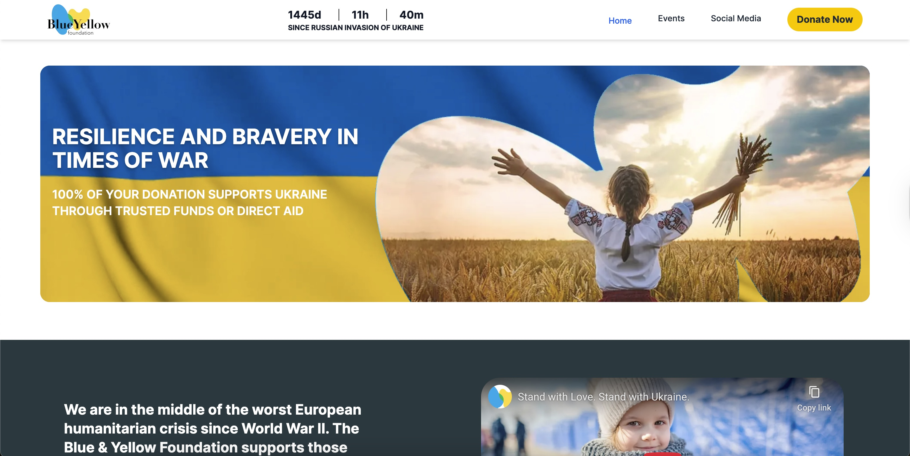
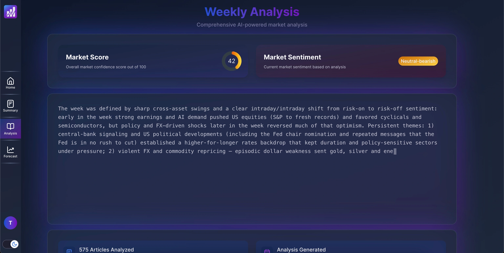
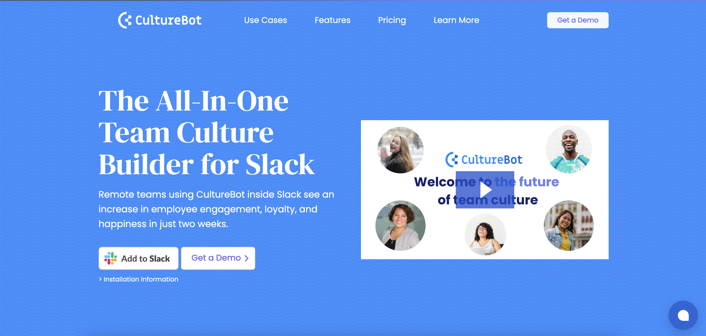
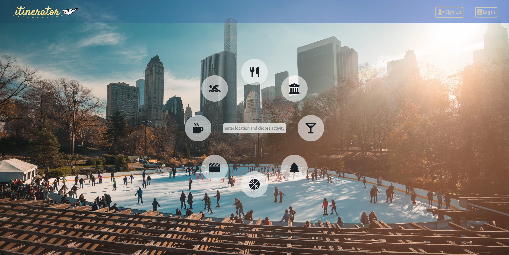

 

<h3 align="left">
Senior Software Engineer focused on building scalable, high-performance web applications.
  
I specialize in the React ecosystem, with hands-on experience designing and delivering complex UI systems using
<b>TypeScript</b>, <b>React</b>, <b>MUI</b>, and <b>Next.js</b>. I enjoy working on real-time, data-heavy products and turning complex requirements into maintainable, production-ready solutions.
  
Always open to collaboration and interesting technical challenges. Feel free to
<a href="https://antonjames.dev/#contact">reach out</a>
or explore my
<a href="https://antonjames.dev/">portfolio</a>.
</h3>

  <h3 style="font-size: 24px;">Core Expertise</h3>
  
  <h3 style="font-size: 24px;">Additional Experience</h3>
  
  

  <h3 style="font-size: 28px;">Projects</h3>

  <h2>Multiple Cybersecurity Platforms</h2>
  
Architected a scalable cybersecurity threat analytics platform using React, TypeScript, Next.js, GraphQL, and MUI, led a zero-downtime migration of 900+ components, built an 81-component internal UI library adopted by 4 teams, engineered a multi-layer theming system, contributed performance improvements to open-source visualization libraries, and optimized the public Next.js application to increase unique user traffic by 19%.

 
  

  <h2>Blue & Yellow (Online Donation & Fundraising Platform)</h2>
  
Led the development and deployment of a full-stack platform using JavaScript, React, Next.js, Tailwind CSS, and PostgreSQL, designing API endpoints for full CRUD functionality, optimizing data storage and retrieval to reduce load times and external API costs, implementing SSR to cut page load from 4.11s to 2.13s and boost SEO, and building a fully responsive, accessible UI across devices.

  

    <a href="https://blueyellowfoundation.org/">Live Link</a>
  

   
  

  <h2>Invest Pulse (Stock Market Analytics Platform)</h2>
  
Designed a token-based design system unifying Tailwind CSS and MUI to reduce styling inconsistencies and accelerate feature development, integrated OpenAI APIs to deliver AI-driven insights, implemented interactive real-time financial charts with the TradingView API, and deployed the application on Vercel with environment-based CI/CD workflows to support future scaling and SaaS readiness.

  

    <a href="https://investpulse.vercel.app/">Live Link</a>
  

   
  

  <h2>Culture Bot (AI-driven Conversational Platform)</h2>
  
Integrated an AI conversational layer using Python and the OpenAI API to deliver contextual responses and enhance employee engagement, while automating content extraction and preprocessing with BeautifulSoup to ensure consistent data delivery to the application layer.

  

    <a href="https://getculturebot.com/">Live Link</a>
  

   
  

  <h2>Itinerator (Personalized Activity Recommender)</h2>
  
Built an interactive web application with React, implementing React Router for client-side navigation, employing Redux to centralize state management and reduce unnecessary re-renders, and collaborating with backend engineers to optimize data retrieval from MongoDB and Web Services in an Agile environment.

  

    <a href="https://excursionexplorer.onrender.com/">Live Link</a>
  

   
  

  <h2>Torque (Fast-paced Racing Game)</h2>
  
Developed a fast-paced arcade game using vanilla JavaScript, implementing custom game physics and challenging gameplay, leveraging the Canvas API for smooth visual effects, and applying OOP principles to enhance code efficiency and reduce development time over 10+ hours.

  

    <a href="https://antonjames-sistence.github.io/Torque/">Live Link</a>
  

   
  
   
   
   
   <h2 style="font-size: 24px;">Outside of work</h2>
  <h3>
  ⛸️ Ice skating · 📚 Reading · 🍲 Cooking · 🎨 Painting
  </h3>
  

  <h2 style="font-size: 24px;">Contacts</h2>

   &nbsp;&nbsp;&nbsp;
   &nbsp;&nbsp;&nbsp;
   &nbsp;&nbsp;&nbsp;

